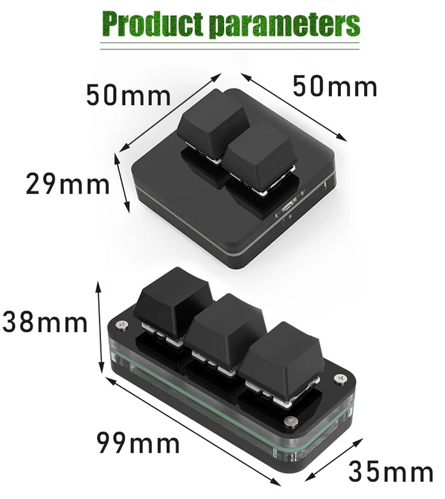

# micro-keyboard-to-control-isp-and-micmute

Turn a cheap 2-key USB macro pad into a desk control panel for a Windows PC:

- **Button #1** swaps the active internet uplink (WAN) on a MikroTik router between two ISPs.
- **Button #2** mutes / unmutes the Windows default microphone.
- **The keyboard LED** shows both states at once.

<p align="center">
  
</p>

| State | LED (both LEDs) |
|---|---|
| Mic **muted** | steady ISP color |
| Mic **live** | white the moment it goes live, then an Airbus-style double strobe: white 0.1 s · ISP 0.1 s · white 0.1 s · ISP 1 s, repeating |
| ISP swap in progress | green ↔ yellow, fast blink |
| Router error / swap failed | red |

ISP colors are set per ISP in `config.toml`.

## Requirements

- Windows (USB HID via `pywinusb`, mic via Windows Core Audio / `pycaw`).
- A mini keyboard that speaks the `MINI_KEYBOARD.exe` LED protocol. Tested with the
  **2-key, 50 × 50 mm** pad pictured above, USB `514C:8851`. The 3-key variant and other
  brands of the same board may work with different IDs (see
  [Find your keyboard's device ID](#1-find-your-keyboards-device-id)). The code assumes two
  buttons; a third key just keeps whatever the vendor app maps it to.
- The vendor's configuration app, `MINI_KEYBOARD.exe`, used once to map the buttons. It's
  supplied by the seller and isn't redistributed in this repo. The version used here came as
  `New_English_software_is_set_in_the_upgrade_model-20250318.7z`. Extract it to its own
  folder and run `MINI_KEYBOARD.exe` from there.
- [uv](https://docs.astral.sh/uv/) and Python 3.12+ from the official installer.
- A MikroTik reachable over SSH with key auth (tested on RouterOS 6.42).

## Setup

```powershell
copy config.example.toml config.toml   # then edit it (see below)
uv sync
uv run find_device.py                  # find the keyboard's VID/PID
.\run.ps1 -Check                       # install, compile the .exe, run the startup checks only
.\run.ps1                              # run it
```

`run.ps1` installs anything missing (uv and Python 3.12 via winget, then the Python
packages), recompiles `dist\isp_switcher\isp_switcher.exe` when a source file changes,
and runs it. Use `-Rebuild` to force a recompile. During development,
`uv run isp_switcher.py` runs the same code without compiling.

### 1. Find your keyboard's device ID

These pads are sold under many brands, and the USB VID/PID can differ from the tested
`514C:8851`. The switcher only talks to the device set in `config.toml`:

```toml
[keyboard]
vid = "0x514C"
pid = "0x8851"
```

**a. Let the helper find it.** It lists every HID device and marks the ones that accept
the LED protocol (HID output report 3):

```powershell
uv run find_device.py
```

```
  VID    PID    ifaces LED?  name
  046D   C31C   4      -     Logitech / USB Keyboard
  514C   8851   2      YES   USB Keyboard          <- this one
```

**b. If several devices match, or none do, use the plug/unplug diff.** It shows only
the device that appears when you plug the keyboard in:

```powershell
uv run find_device.py --diff
```

**c. Confirm before using it.** This flashes the LEDs red → green → blue on that
device. It sends live frames only, so the saved power-on color is untouched:

```powershell
uv run find_device.py --test 0x514C 0x8851
```

**Without the helper:** open Device Manager → *Human Interface Devices* or *Keyboards* →
the pad → *Properties* → *Details* → *Hardware Ids*, and read `VID_xxxx&PID_yyyy`.
Or in PowerShell:

```powershell
Get-PnpDevice -PresentOnly | Where-Object InstanceId -like 'USB\VID_*' |
  Select-Object FriendlyName, InstanceId
```

**Keyboard lights up but never shows up?** It's almost always a **charge-only USB cable**:
the pad gets power and shows its last saved color, but Windows sees no data device at all.
Use a data cable, plug straight into the PC instead of an unpowered hub, and set the pad
to wired mode if it has a USB/BT/2.4G switch.

### 2. Map the buttons

In the vendor app (`MINI_KEYBOARD.exe`), set button #1 and button #2 to send keys
nothing else uses, e.g. **F18** and **F19**. Put the same names in `config.toml`:

```toml
[keys]
isp = "f18"
mic = "f19"
```

Key names are [pynput](https://pynput.readthedocs.io/) `Key` names (`f13`–`f24`,
`media_play_pause`, …) or a single character. When the switcher is running, every press
of a mapped key prints a `[key] Key.f18 pressed …` line, so you can check the mapping.

### 3. Microphone

The mic key acts on the **microphone(s) an app is recording from right now**. Meet, Teams,
Discord and others often use a mic chosen in their own settings, not the Windows default.
When nothing is recording, it falls back to the Windows default mic (Settings → System →
Sound → Input). The target is re-checked every 0.5 s, so starting a call or plugging in a
headset just works.

- One press: if any target mic is live, all of them are muted; if all are muted, all are
  unmuted.
- The LED shows "live" while any target mic is live.
- The console prints `[mic] target: <device>` when the target changes, and
  `[mic] LIVE` / `[mic] MUTED` when the state changes, including changes made by other apps.

This is a Windows-level mute: the app receives silence, so nothing can record you, but the
app's own mute button doesn't change. Meet may show "your mic is muted in system settings".

### 4. Router

Fill in `[router]` and the two `[[isp]]` entries, and set up the router as described in
[MikroTik setup](#mikrotik-setup). On startup the switcher prints
`[startup] active ISP = …`. If it can't reach the router, it prints the error and the
LED turns red.

`config.toml` holds everything site-specific (router address, user, key path, ISP route
comments) and is git-ignored. Settings left out of `[router]` fall back to the matching
`Host` block in `~/.ssh/config`. Use `ISP_SWITCHER_CONFIG` to point to another file.

### Run elevated

Global key capture uses a low-level keyboard hook. Windows (UIPI) hides keystrokes from
a non-elevated hook while an **elevated** window (e.g. an admin terminal) has focus.
So run the switcher elevated. The logon task below does that for you.

### Run in the background at logon

A Windows *service* can't do this job: services run in session 0, which has no access to
your keyboard hook or your user audio session. `install-task.ps1` registers a
**Task Scheduler** task instead, which behaves like a service:

```powershell
.\run.ps1 -Check            # build dist\isp_switcher\ first
.\install-task.ps1          # elevated PowerShell: install/update + start
.\install-task.ps1 -Status  # task state, PID, last log lines
.\install-task.ps1 -Stop    # e.g. before rebuilding
.\install-task.ps1 -Start
.\install-task.ps1 -Uninstall
```

What the task does:
- Starts `dist\isp_switcher\isp_switcher_bg.exe` (no window) 30 s after you log on.
- Runs with highest privileges.
- Passes `--wait 300`, which retries failed startup checks for up to 5 minutes while
  the network, router and USB devices come up.
- Has no time limit, keeps running on battery, and restarts if it crashes.

Only one copy runs per session. A second copy (e.g. `.\run.ps1` while the task runs) exits
with code 3 instead of doubling every key press. `run.ps1` refuses to rebuild while the
task's exe is running; stop it first with `-Stop`.

### Logs

Everything the switcher prints, including tracebacks from crashed threads, also goes to
`isp_switcher.log`, rotated by size:

```toml
[log]
dir = "log"      # relative to config.toml, or absolute, e.g. "D:/logs/isp-switcher"
max_mb = 5       # rotate when the file reaches this size
backups = 5      # keep isp_switcher.log.1 .. .5; the oldest is dropped
```

Interactive runs show the same lines in the console; the background exe writes only to
the log.

```
2026-10-28 13:38:25,332 INFO  [startup] active ISP = ISP-A -> LED blue
2026-10-28 13:38:25,336 INFO  [mic] MUTED
```

### One mic toggler only

If another app (e.g. MicMute) also toggles the mic on the same key, one press mutes
*and* unmutes. Either clear that app's hotkey, or set `keys.mic_toggle_by_script = false`
so the other app toggles and the LED just follows the mic state.

## MikroTik setup

The switcher doesn't manage your whole router. It identifies the active ISP from the
comment on the active `0.0.0.0/0` route, and swaps by setting `distance=1` on the
target ISP's route and `distance=2` on the other. Everything else stays yours.

### Minimum requirements

These are checked at every start (`.\run.ps1 -Check` runs only the checks). Any failure
is **fatal**:

| # | Requirement | Why |
|---|---|---|
| R1 | Each ISP has **exactly one** enabled `0.0.0.0/0` route whose comment matches its `route_comment` | the switcher changes routes by comment |
| R2 | No route comment matches **both** ISPs | otherwise one swap would move both routes |
| R3 | No **other** enabled default route (static or DHCP/PPPoE-added) has `distance` ≤ 2 | it would tie with or beat the routes being swapped, so the swap would do nothing |
| R4 | The SSH user's group has the **`write`** policy | needed to change distances and flush conntrack |

Also fatal: the `[router]` login fails, or the device isn't a MikroTik.

These only print a **warning**: an ISP route without `check-gateway`, a distance other
than 1 or 2 (fixed by the first swap), neither ISP route active right now, or a RouterOS
version other than 6.x (tested on 6.42).

> `route_comment` is matched the way RouterOS does it: as a **case-sensitive regex**
> (`comment~"…"`). Use plain words like `ISP A`, and avoid `. * + ? ( ) [ ]`.

### Step-by-step (RouterOS 6, terminal)

The example uses `ether1` = ISP A (gateway `192.0.2.1`) and `ether2` = ISP B
(gateway `198.51.100.1`). Use your own interfaces and gateways.

**1. A dedicated SSH user with key login.** RouterOS 6 only accepts RSA keys:

```powershell
ssh-keygen -t rsa -b 2048 -f $HOME\.ssh\id_rsa_router -N '""'
scp -o HostKeyAlgorithms=+ssh-rsa -o PubkeyAcceptedAlgorithms=+ssh-rsa -o MACs=+hmac-sha1 `
    $HOME\.ssh\id_rsa_router.pub admin@192.168.88.1:
```

```
/user group add name=isp-switcher policy=ssh,read,write
/user add name=isp-switcher group=isp-switcher password="<long random, never used>"
/user ssh-keys import public-key-file=id_rsa_router.pub user=isp-switcher
/ip service set ssh address=192.168.88.0/24
```

Then in `config.toml`: `user = "isp-switcher"`, `key_file = "~/.ssh/id_rsa_router"`,
`legacy_ssh_rsa = true`. You can also upload the `.pub` file by drag-and-drop in WinBox → Files.

**2. Stop the WANs from adding their own default routes.** Otherwise R3 fails:

```
/ip dhcp-client set [find interface=ether1] add-default-route=no
/ip dhcp-client set [find interface=ether2] add-default-route=no
# PPPoE: /interface pppoe-client set [find] add-default-route=no
```

**3. One default route per ISP**, with a comment containing its `route_comment`.
Recursive routes are recommended: each ISP is checked by pinging a public IP *through* it,
so the router also fails over by itself when an ISP goes down upstream, not just when the
cable is unplugged.

```
# host route to each ISP's probe IP, pinned to that ISP's gateway
/ip route add dst-address=8.8.8.8/32 gateway=192.0.2.1    scope=10 comment="probe ISP A"
/ip route add dst-address=8.8.4.4/32 gateway=198.51.100.1 scope=10 comment="probe ISP B"

# the two default routes the switcher toggles (distance 1 = active, 2 = standby)
/ip route add dst-address=0.0.0.0/0 gateway=8.8.8.8 check-gateway=ping distance=1 scope=30 target-scope=10 comment="Recursive ISP A"
/ip route add dst-address=0.0.0.0/0 gateway=8.8.4.4 check-gateway=ping distance=2 scope=30 target-scope=10 comment="Recursive ISP B"
```

Only `0.0.0.0/0` routes are matched against `route_comment`, so the probe routes may share
words with it. Use a different probe IP per ISP: while that host route exists, the IP is
only reachable through its ISP.

Simpler, non-recursive variant: `gateway=192.0.2.1 check-gateway=ping` directly on the
default route. That only notices a dead gateway, not a dead upstream.

**4. Disable or demote any other default route** (R3):

```
/ip route print where dst-address=0.0.0.0/0
/ip route disable [find where dst-address=0.0.0.0/0 and !(comment~"Recursive ISP")]
# or keep one as a last resort: ... set [find ...] distance=5
```

**5. NAT for each WAN**, unless the upstream modem already NATs your LAN subnet:

```
/ip firewall nat add chain=srcnat out-interface=ether1 action=masquerade comment="WAN ISP A NAT"
/ip firewall nat add chain=srcnat out-interface=ether2 action=masquerade comment="WAN ISP B NAT"
```

**6. Verify.** Then fix anything the preflight reports:

```
/ip route print detail where dst-address=0.0.0.0/0
```

```powershell
.\run.ps1 -Check
```

RouterOS 7 (untested): the same commands work, but recursive default routes need
`target-scope=11` instead of `10`.

### Why the switcher flushes conntrack

Connection tracking pins every flow to the NAT decision made when it started. After a WAN
swap, old flows keep leaving with the old WAN's source address, and the new ISP drops them.
For example, a `ping -t` (Windows reuses ICMP id 1) never recovers, and TCP entries live
for a day. So after every confirmed swap the switcher removes conntrack entries whose
destination doesn't match `conntrack.keep_dst_regex` (LAN / VPN ranges), which makes them
re-NAT on the new WAN. Measured result: a continuous ping across both swap directions
loses 0 packets. Open TCP connections still reset, because the public IP changes.

## Keyboard LED protocol

HID output report ID 3, 65 bytes, reverse-engineered from `MINI_KEYBOARD.exe`:

```
set:    03 FE B0 01 08 00 00 00 00 00 01 00 [CM] 00…
commit: 03 FD FE FF 00…
```

`CM` = color (high nibble) | mode (low nibble).

| Color nibble | 1 red · 2 orange · 3 yellow · 4 green · 5 cyan · 6 blue · 7 purple · 0, 8–F white |
|---|---|
| **Mode nibble** | 0 off · 1 steady · 2 fast blink · 3/4 press-reactive · 5 steady white · 6–F rejected |

Findings from `led_probe.py`:

- Both LEDs always share one color. There is no per-key color command; only the
  press-reactive modes light the keys separately.
- A **color** change shows live without `commit`. A **mode** change only takes effect
  after `commit`.
- `commit` appears to save the state as the power-on color (flash). The controller
  sends it only when the steady color actually changes, never for blink frames or
  refreshes.
- There is no live "off" color, so blinks alternate with white.

`led_probe.py` re-runs the experiments interactively. Stop the switcher first:

```powershell
uv run led_probe.py          # mode sweep
uv run led_probe.py colors   # color nibbles
uv run led_probe.py blink    # hardware blink preview
uv run led_probe.py headers  # can the LEDs be split?
```

## Files

| File | Purpose |
|---|---|
| `isp_switcher.py` | main service: keys, swap/revert logic, LED state |
| `mikrotik_client.py` | SSH to RouterOS: read/switch default route, flush conntrack |
| `led_controller.py` | keyboard LED over HID: colors, blink, replug recovery |
| `mic_controller.py` | default-mic mute toggle + state polling |
| `run.ps1` | install, compile to `.exe`, run |
| `install-task.ps1` | logon task: install / status / stop / start / uninstall |
| `isp_switcher.spec` | PyInstaller build: console `isp_switcher.exe` + windowless `isp_switcher_bg.exe` |
| `log_setup.py` | tees all output into the rotating log file |
| `preflight.py` | startup checks (fatal / warning), incl. the router minimum requirements |
| `config.py` | loads and validates `config.toml` |
| `find_device.py` | finds and confirms the keyboard's USB VID/PID |
| `led_probe.py` | interactive LED protocol experiments |
